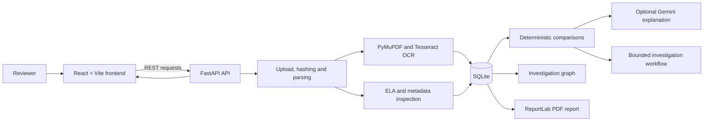

# PRISMORA AI

**See Beyond the Surface. Discover the Evidence.**

PRISMORA AI is a document-forensics and contextual investigation application. It helps reviewers examine related documents together, trace potential discrepancies to source evidence, inspect visual indicators, and create investigation reports.

> **Evidence disclaimer:** PRISMORA AI surfaces observations and potential anomalies for human review. OCR errors, mismatched fields, metadata, or Error Level Analysis (ELA) results do not by themselves establish fraud or document tampering.

## The problem and the approach

Documents are often verified one at a time, making it difficult to notice conflicts between an application, a supporting record, and other evidence. PRISMORA links uploaded documents, extracted fields, findings, and evidence within an investigation. Deterministic comparisons run first; Gemini can optionally provide additional context when configured.

## Current capabilities

- Create and manage investigations through a React web interface and FastAPI API.
- Upload PDF and image documents, calculate SHA-256 hashes, and retain source-file references.
- Extract PDF text and word positions with PyMuPDF; use Tesseract for image OCR and OCR fallback.
- Extract a defined set of names, financial values, addresses, dates, and reference IDs using field-specific patterns.
- Run deterministic salary, invoice-total, and address comparisons with supporting field references and alternative explanations.
- Inspect rendered pages using ELA and read PDF or image metadata; save visual evidence images where applicable.
- Review findings, inspect a database-backed relationship graph, and generate PDF reports from investigation data.
- Record bounded investigation steps and tool results in the database.
- Optionally request Gemini contextual explanations. Deterministic analysis remains available without a Gemini key.

## Application interface

The React application provides a public product landing page and a responsive investigation workspace. The workspace uses a desktop sidebar and mobile bottom navigation:

| Route | Purpose |
|---|---|
| `/` | Product overview, implemented capabilities, and investigation workflow. |
| `/dashboard` | Live investigation, document, finding, and pending-review totals; recent cases; and sample-case launch actions. |
| `/documents` | Searchable registry of source files and their investigation, type, page count, file size, and hash-recorded status. |
| `/investigations/new` | Create an investigation, select an included sample case, or upload supported documents. |
| `/investigations/{id}` | Investigation overview, findings, document inventory, extracted-data matrix, and analysis activity. |
| `/investigations/{id}/evidence` | Review rendered source pages, ELA images, extracted observations, and finding review decisions. |
| `/investigations/{id}/graph` or `/graph` | Explore graph relationships generated from stored investigation data. |
| `/reports` | Generate and download PDF summaries for stored investigations. |
| `/settings` | Check live API, database, OCR, and optional Gemini status. |

Dashboard metrics and document listings are fetched from the backend; an empty or unavailable registry is not replaced with sample statistics. The sample-case buttons intentionally create investigations from the included synthetic dataset. For real case conclusions, consult the source pages and reviewer records rather than relying on automated flags alone.

### Capability boundaries

The current implementation is a focused prototype, not a general-purpose forensic verification system. OCR and field extraction are limited by input quality and the implemented patterns. ELA is a heuristic, not a tampering verdict. The investigation agent uses a bounded set of database tools; it is not an unrestricted autonomous agent. See [Known limitations](docs/limitations.md) before relying on results.

## Architecture



## Six intelligence engines

| Engine | Role in the current implementation |
|---|---|
| **DocMind** | Accepts PDF/image files, hashes uploads, extracts PDF text or image OCR, and recognizes a defined set of structured fields. |
| **PixelTrace** | Produces ELA comparisons for rendered pages, inspects basic file metadata, and can save evidence crops. ELA differences require human interpretation. |
| **ContextIQ** | Applies deterministic rules to supported salary, invoice-total, and address fields, attaches source-field references, and optionally requests Gemini explanations. |
| **CrossDoc Graph** | Serves investigation relationships from the database for display in the React Flow interface. |
| **EvidenceVault** | Uses SQLAlchemy and SQLite to store investigations, document hashes, extracted fields, observations, findings, evidence references, agent actions, and review decisions. Uploaded files and generated evidence are stored under the configured storage directory. |
| **DossierGen** | Generates downloadable PDF reports using ReportLab and investigation records. |

### Investigation workflow

The backend runs document processing and deterministic comparisons before the bounded investigation cycle. The agent records `OBSERVE`, `PLAN`, investigation/tool-call, `CORRELATE`, and `EXPLAIN` activity, subject to a configured tool-call budget. Gemini is an optional contextual explanation service; it is not required for deterministic findings.

## Technology stack

- **Frontend:** React, TypeScript, Vite, Tailwind CSS, React Router, TanStack Query, React Flow, Recharts, Lucide
- **Backend:** Python, FastAPI, Pydantic Settings, SQLAlchemy, SQLite
- **Documents and vision:** PyMuPDF, Pillow, NumPy, OpenCV, pytesseract with the Tesseract executable
- **Contextual explanations:** Google Gemini API (`google-genai`)
- **PDF reports:** ReportLab
- **Tests:** pytest and HTTPX

## Repository layout

```text
backend/
  app/
    api/                 FastAPI endpoints
    core/                Application settings
    database/            SQLAlchemy engine and sessions
    models/              Investigation and evidence models
    schemas/             API request and response schemas
    services/            OCR, ingestion, comparisons, forensics, agent, reports
  tests/                 API/pipeline and dataset tests
dataset/                 Synthetic benchmark documents and ground truth
docs/                    Architecture, methodology, limitations, integration matrix
scripts/                 Synthetic dataset generator
src/                     React frontend
storage/                 Runtime uploads and generated evidence (not committed)
```

## Requirements and setup

- Python 3.10 or later
- Node.js compatible with Vite 8
- Tesseract OCR installed and available on `PATH`
- A Gemini API key only for Gemini-powered explanations

Backend storage and database defaults resolve from the repository directory. Create Python and JavaScript dependencies, then start the application:

```bash
python -m venv .venv
# Windows PowerShell:
.\.venv\Scripts\Activate.ps1
# macOS/Linux instead:
# source .venv/bin/activate
python -m pip install -r backend/requirements.txt
npm install
npm run dev
```

Open [http://localhost:3000](http://localhost:3000). The Node development server serves the frontend and starts a Python FastAPI backend on port `5000`, proxying API and storage requests.

To enable Gemini explanations, set `GEMINI_API_KEY` in the environment before launching the server. No key is required for deterministic processing. Never commit a real key.

For the API server alone, with the Python environment active and from the repository root:

```bash
python -m uvicorn backend.app.main:app --host 127.0.0.1 --port 5000
```

Useful URLs:

- Frontend: [http://localhost:3000](http://localhost:3000)
- Health endpoint: [http://localhost:3000/api/health](http://localhost:3000/api/health)
- FastAPI interactive documentation: [http://localhost:5000/docs](http://localhost:5000/docs) when the backend is running

## Environment configuration

The backend reads `GEMINI_API_KEY` and `GEMINI_MODEL` from the environment. The checked-in `.env.example` is a template; do not put real credentials in it. Storage, dataset, and SQLite defaults are relative to the repository and can be overridden with the corresponding settings environment variables.

## API overview

FastAPI exposes interactive schema documentation at `/docs`. Main endpoints include:

| Method | Path | Purpose |
|---|---|---|
| `GET` | `/api/health` | Report backend, database, and Gemini configuration status. |
| `POST` | `/api/investigations` | Create an investigation. |
| `GET` | `/api/investigations` | List investigations. |
| `GET` | `/api/investigations/{id}` | Retrieve an investigation. |
| `GET` | `/api/documents` | List source documents across investigations, including investigation titles. |
| `POST` | `/api/investigations/{id}/documents` | Upload one or more documents. |
| `GET` | `/api/investigations/{id}/documents` | List investigation documents. |
| `GET` | `/api/documents/{id}` | Retrieve a document. |
| `GET` | `/api/documents/{id}/fields` | List extracted fields. |
| `POST` | `/api/investigations/{id}/analyze` | Run the investigation pipeline. |
| `GET` | `/api/investigations/{id}/findings` | List findings. |
| `GET` | `/api/findings/{id}/evidence` | Retrieve evidence references for a finding. |
| `POST` | `/api/findings/{id}/review` | Record a finding review. |
| `GET` | `/api/investigations/{id}/graph` | Retrieve graph nodes and relationships. |
| `GET` | `/api/investigations/{id}/report` | Generate and download a PDF report. |

## Synthetic benchmark dataset

The repository includes 12 synthetic PDF documents and rendered PNGs across three cases:

1. **Financial discrepancy:** declared income compared with payroll, bank deposit, and tax records.
2. **Address inconsistency:** an application address compared with utility, lease, and employer records.
3. **Visual document anomaly:** authentic and altered invoice examples with supporting purchase-order and shipping records.

All names, organizations, addresses, and values are fictional. Case descriptions are in [dataset/README.md](dataset/README.md); expected values and document hashes are in `dataset/ground_truth.json`.

The generator writes the benchmark under the repository's `dataset/` directory and creates runtime storage directories:

```bash
python scripts/generate_synthetic_dataset.py
```

## Tests and checks

Run the backend tests from the workspace root:

```bash
python -m pytest backend/tests -v
```

The frontend checks are:

```bash
npm run lint
npm run build
```

These are available test commands; test results are not implied by this documentation.

## Limitations and future work

Current limitations include template/pattern-limited structured extraction, reliance on a locally installed Tesseract executable for image OCR, and the heuristic nature of visual indicators. Gemini explanations depend on an external API key and service availability. Review [docs/limitations.md](docs/limitations.md) and [docs/methodology.md](docs/methodology.md) for additional context.

Potential future work includes portable runtime-path configuration, broader OCR and field extraction with measured benchmark results, stronger upload and error-handling tests, and an evaluation report comparing observed outputs with dataset ground truth.
